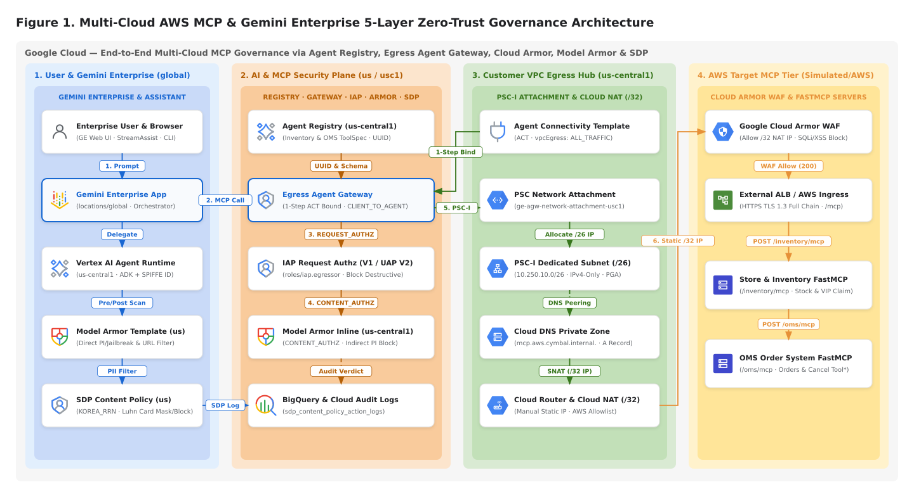
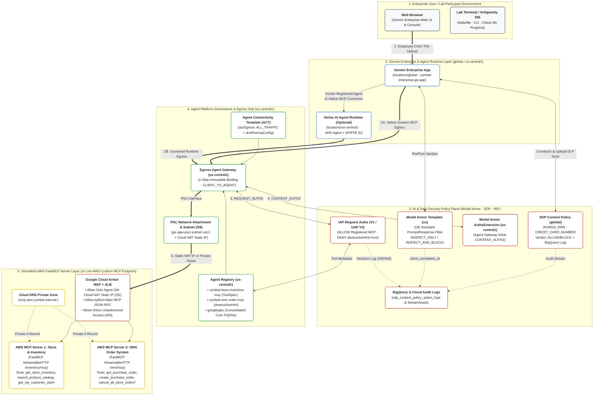

# Gemini Enterprise — `Agent Registry` + `Agent Gateway` + `Cloud/Model Armor` + `SDP` 통합 `Hands-On Lab` & `Demo Repository`

> **End-to-End Zero-Trust Governance Lab for `Gemini Enterprise` with `AWS Custom MCP Servers`, `Agent Registry`, `Egress Agent Gateway`, `Google Cloud Armor`, `Model Armor`, and `Sensitive Data Protection (SDP)`**

본 `Repository`([`https://github.com/rhkim77/ge-agent-gateway-mcp`](https://github.com/rhkim77/ge-agent-gateway-mcp))는 엔터프라이즈 환경에서 외부 클라우드(`AWS`) 또는 사내망에 호스팅된 **`Custom MCP Server`**들을 **`Agent Registry` (`us-central1`)**에 등록하고, **`Egress Agent Gateway` (`PSC-I` / `Cloud NAT`)**, **`Google Cloud Armor` (`Edge WAF`)**, **`Model Armor` (`Prompt Injection` 방어)**, **`Sensitive Data Protection` (`SDP Content Policy` 개인정보 보호)**, 그리고 **`IAP` 접근 제어(`destructiveHint` 위험 도구 차단)**가 결합된 환경에서 **`Gemini Enterprise (GE)`**를 단계별로 구축·검증할 수 있는 **`Qwiklabs` 형태의 핸즈온 `Demo` 패키지**입니다.

---

## 1. 핵심 아키텍처 개요 (`Target Architecture Overview`)

엔터프라이즈 환경에서 `Gemini Enterprise`가 외부 클라우드(`AWS`)의 `Custom MCP Server`를 안전하게 호출하기 위해서는 **네트워크 경계(`Network Perimeter`)**, **도구 호출 인가(`Tool-Level Authorization`)**, **입출력 페이로드 보안(`Content Sanitization & DLP`)**의 3중 방어선이 결합되어야 합니다.

1. **`Agent Registry` (`us-central1`) 기반 전사 `MCP` 자산 가시성 및 위험도 주석(`Annotations`)**:
   - 외부 `AWS MCP Server`의 엔드포인트(`protocolBinding=JSONRPC`, `/mcp`)와 개별 `Tool`의 위험도 메타데이터(`readOnlyHint`, `destructiveHint`) 및 `ALL_TRAFFIC` 필수 `googleapis` 통합 카탈로그를 중앙 등록합니다.
2. **`1-Step Immutable` `Egress Agent Gateway` + `Agent Connectivity Template (ACT)`**:
   - `Agent Gateway`의 네트워크 바인딩 불변성(`Immutability at creation`) 원칙에 따라 `PSC Network Attachment`(`/26` `Subnet`), `Cloud NAT` 고정 `IP`(`ENDPOINT_TYPE_VM,ENDPOINT_TYPE_SWG`), `Cloud DNS Private Zone`을 선행 구성한 뒤 `ACT`(`vpcEgress: ALL_TRAFFIC`)와 함께 **단일 단계(`1-Step`)**로 `Agent Gateway`를 생성합니다.
3. **3계층 다중 방어(`3-Layer Defense-in-Depth`) 보안 정책**:
   - **Layer 1 (`Google Cloud Armor` Edge WAF)**: `AWS MCP Server` 앞단(또는 `Edge ALB`)에서 `Agent Gateway`의 `Cloud NAT` 고정 `IP(/32)`만 허용하고, 게이트웨이를 우회한 직접 호출을 `HTTP 403`으로 차단합니다.
   - **Layer 2 (`IAP Request Authz` — `UAP V2` / `IAP V1`)**: `Agent Registry`의 `destructiveHint == true` 주석을 실시간 평가하여, 에이전트 코드 수정 없이 중앙에서 파괴적 도구(`cancel_all_store_orders`, `override_product_unit_price`) 호출을 `HTTP 403`으로 즉시 차단합니다.
   - **Layer 3 (`Model Armor` & `SDP Content Policy`)**: `Gemini Enterprise Assistant`(`locations/us`) 및 `Agent Gateway` 인라인 `CONTENT_AUTHZ`(`locations/us-central1`)에서 간접 프롬프트 인젝션(`Indirect Prompt Injection`)과 민감정보(`KOREA_RRN` 주민등록번호, 유효 `Luhn Checksum` 신용카드 번호)를 탐지·차단하고 `BigQuery` (`ContentPolicyActionLog`)에 감사 증적을 기록합니다.



> **GCP Standard Architecture Diagrams (`SVG` · `2x Retina PNG` · `Draw.io XML`)**:
> - **Master 6-Tab Draw.io Workbook**: [`docs/diagrams/ge-agent-gateway-mcp-all-diagrams.drawio`](docs/diagrams/ge-agent-gateway-mcp-all-diagrams.drawio) *(Open in [diagrams.net / draw.io](https://app.diagrams.net))*
> - **Figure 1 (`E2E 5-Layer Architecture`)**: [`SVG`](docs/diagrams/diagram-1-e2e-5layer-governance-architecture.svg) | [`2x PNG`](docs/diagrams/diagram-1-e2e-5layer-governance-architecture.png) | [`Draw.io`](docs/diagrams/diagram-1-e2e-5layer-governance-architecture.drawio)
> - **Figure 2 (`Challenges vs. 5-Layer Solutions`)**: [`SVG`](docs/diagrams/diagram-2-problems-vs-5layer-solutions.svg) | [`2x PNG`](docs/diagrams/diagram-2-problems-vs-5layer-solutions.png) | [`Draw.io`](docs/diagrams/diagram-2-problems-vs-5layer-solutions.drawio)
> - **Figure 3 (`7-Step Immutable Provisioning Order`)**: [`SVG`](docs/diagrams/diagram-3-immutable-provisioning-sequence.svg) | [`2x PNG`](docs/diagrams/diagram-3-immutable-provisioning-sequence.png) | [`Draw.io`](docs/diagrams/diagram-3-immutable-provisioning-sequence.drawio)
> - **Figure 4 (`PSC-I & Cloud NAT /32 Packet Flow`)**: [`SVG`](docs/diagrams/diagram-4-psci-act-cloud-nat-packet-flow.svg) | [`2x PNG`](docs/diagrams/diagram-4-psci-act-cloud-nat-packet-flow.png) | [`Draw.io`](docs/diagrams/diagram-4-psci-act-cloud-nat-packet-flow.drawio)
> - **Figure 5 (`Dual-Location Model Armor & SDP`)**: [`SVG`](docs/diagrams/diagram-5-dual-model-armor-sdp-inspection.svg) | [`2x PNG`](docs/diagrams/diagram-5-dual-model-armor-sdp-inspection.png) | [`Draw.io`](docs/diagrams/diagram-5-dual-model-armor-sdp-inspection.drawio)
> - **Figure 6 (`AWS Hybrid Egress Paths A & B`)**: [`SVG`](docs/diagrams/diagram-6-aws-hybrid-egress-paths.svg) | [`2x PNG`](docs/diagrams/diagram-6-aws-hybrid-egress-paths.png) | [`Draw.io`](docs/diagrams/diagram-6-aws-hybrid-egress-paths.drawio)

<details>
<summary><b>View Editable Mermaid Source (Google Cloud Standard Palette)</b></summary>



</details>

---

## 2. `Repository` 디렉토리 구조 (`Repository Layout`)

본 저장소는 **(A) 고객 자체 `GCP Sandbox Project`에서 즉시 실행하는 `Self-Service CLI/Console Mode`**와 **(B) `Qwiklabs` 플랫폼에 그대로 배포할 수 있는 `Qwiklabs V2 Content Bundle` (`labs/ce-ge-agent-gateway-mcp-governance/`)**을 동시에 제공합니다.

```text
ge-agent-gateway-mcp/
├── README.md                                      # 전체 아키텍처 개요, Quickstart, 6단계 실습 요약
├── PLAN_DEMO_ARCHITECTURE_KR.md                   # 상세 아키텍처 설계 및 구성계획서
├── Makefile                                       # 단계별 실행 및 로컬 채점 명령어 (task1..task6, check-progress)
├── pyproject.toml                                 # Python 의존성 정의 (uv / pip 호환)
├── .env.example                                   # 환경변수 설정 템플릿
│
├── docs/                                          # [Qwiklabs 스타일 실습 지침서, Console UI 매뉴얼 & GCP 표준 다이어그램]
│   ├── QWIKLABS_HANDS_ON_LAB_GUIDE_KR.md          # Qwiklabs 스타일 6-Task Step-by-Step 실습 가이드
│   ├── CONSOLE_UI_CLICK_BY_CLICK_GUIDE_KR.md      # 스크립트 없이 GCP Console 웹 UI 메뉴만으로 구성하는 가이드
│   ├── AWS_MCP_FIREWALL_AND_NAT_INTEGRATION.md    # 실제 AWS MCP Server 연결 시 Security Group / WAF / TLS 가이드
│   └── diagrams/                                  # GCP 표준 아키텍처 다이어그램 6종 (.svg, 2x .png, .drawio & 통합 워크북)
│
├── mock_aws_mcp_servers/                          # [Simulated AWS FastMCP Server 2종 — Cloud Run / AWS 배포 호환]
│   ├── Dockerfile                                 # FastMCP StreamableHTTP 멀티 엔드포인트 컨테이너
│   ├── pyproject.toml                             # 컨테이너 전용 경량 의존성
│   ├── server.py                                  # /inventory/mcp (재고/VIP 클레임) & /oms/mcp (발주/위험 취소 도구)
│   └── sample_payloads/                           # 정상 재고, 주민번호/Luhn 카드번호 클레임, 간접 인젝션 샘플
│
├── registry_specs/                                # [Agent Registry 등록용 ToolSpec & Endpoint 명세 (< 10KB)]
│   ├── cymbal-store-inventory.toolspec.json       # 조회 도구 readOnlyHint=true 주석 명세
│   ├── cymbal-oms-order.toolspec.json             # cancel_all_store_orders / override_product_unit_price에 destructiveHint=true 부여
│   └── core-googleapis-endpoints.yaml             # ALL_TRAFFIC 필수 21개 Google Cloud API FQDN 통합 카탈로그
│
├── policies/                                      # [Cloud Armor, Model Armor, SDP, IAP 선언형 정책 파일]
│   ├── cloud_armor/mcp_edge_waf_policy.yaml       # Agent Gateway Cloud NAT IP(/32) 허용 + 비인가 IP 403 차단 + OWASP 규칙
│   ├── model_armor/ge_assistant_template_us.json  # GE Assistant용 (locations/us)
│   ├── model_armor/agw_inline_template_usc1.json  # Agent Gateway CONTENT_AUTHZ용 (locations/us-central1)
│   ├── sdp/ge_sdp_content_policy.json             # KOREA_RRN, CREDIT_CARD_NUMBER 탐지/차단 + BigQuery 로깅 정책
│   └── iap_authz/                                 # IAP AuthzExtension, AuthzPolicy, UAP V2 / IAP V1 CEL 규칙
│
├── scripts/                                       # [단계별 자동화 실행 스크립트 & 로컬 Activity Tracking 채점기]
│   ├── common.py                                  # 환경변수 로더, ADC 인증, Luhn Checksum 검증기
│   ├── 01_deploy_aws_mock_mcp_and_cloud_armor.py  # [Task 1] Simulated AWS FastMCP 서버 + Cloud Armor WAF 배포
│   ├── 02_register_mcp_in_agent_registry.py       # [Task 2] AWS MCP 2종 및 googleapis를 Agent Registry(us-central1)에 등록
│   ├── 03_provision_act_and_agent_gateway.py      # [Task 3] PSC-I Subnet(/26) + Cloud NAT + ACT + 1-Step Agent Gateway 생성
│   ├── 04_bind_cloud_model_armor_and_sdp.py       # [Task 4/5] Cloud Armor IP 잠금 + Model Armor + SDP + IAP 바인딩
│   ├── 05_bind_ge_and_run_security_scenarios.py   # [Task 6A] GE 연동 및 5대 보안 시나리오 검증
│   ├── 06_query_audit_logs_and_correlation.py     # [Task 6B] BigQuery SDP 로그 + Cloud Armor + StreamAssist 상관분석
│   ├── check_my_progress.py                       # [Self-Assessment] Qwiklabs 채점기 동일 로직의 6단계 로컬 판정기
│   ├── validate_bundle.py                         # GitWhisperer V2 사전 검증 스크립트
│   └── 99_teardown_demo_resources.py              # 역순 의존성 안전 삭제 스크립트
│
├── fragments/                                     # Qwiklabs 표준 공통 프래그먼트 (startqwiklab, gcpconsole)
├── classroom_templates/                           # Qwiklabs 워크숍 ClassroomTemplate
└── labs/
    └── ce-ge-agent-gateway-mcp-governance/        # [Qwiklabs Platform 직접 배포용 표준 V2 Bundle]
        ├── QL_OWNER
        ├── qwiklabs.yaml                          # schema_version: 2, variant: gcp_medium_extra, allowed_locations_constraint: NONE
        ├── assessment.yaml                        # 6 Steps Activity Tracking (100점 만점, Pass >= 75%)
        ├── assessments/                           # Ruby 채점 스크립트 6종 (step_1..step_6.rb)
        ├── instructions/                          # en.md 및 img/
        └── terraform/                             # 모듈형 Terraform (runtime.yaml v1.4.6, proxy.tf, antigravity.tf, main.tf)
```

---

## 3. 빠른 시작 가이드 (`Quickstart Guide`)

### 3.1 사전 요구사항 (`Prerequisites`)
- `Google Cloud SDK` (`gcloud`) 설치 및 인증 완료:
  ```bash
  gcloud auth login
  gcloud auth application-default login
  ```
- `Python 3.10+` 및 [`uv`](https://docs.astral.sh/uv/) (또는 표준 `venv`/`pip`)
- 대상 `Google Cloud Project`에서 `Owner` 또는 `Editor` + `Network Services Admin` + `Agent Registry Admin` + `Model Armor Admin` + `DLP Admin` 권한 보유

### 3.2 설치 및 환경변수 구성
```bash
# 1. Repository 클론 및 디렉토리 이동
git clone https://github.com/rhkim77/ge-agent-gateway-mcp.git
cd ge-agent-gateway-mcp

# 2. Python 의존성 패키지 설치
make install

# 3. 환경변수 파일(.env) 생성 및 PROJECT_ID 입력
cp .env.example .env
vi .env
```

### 3.3 6단계 핸즈온 실습 실행 (`Step-by-Step Execution`)

| 단계 | 실행 명령어 (`Make Target`) | 대응 `Script` | 주요 수행 작업 및 검증 포인트 |
| :---: | :--- | :--- | :--- |
| **Task 1** | `make task1-deploy-mcp` | `scripts/01_deploy_aws_mock_mcp_and_cloud_armor.py` | `Simulated AWS FastMCP Server` 2종(`/inventory/mcp`, `/oms/mcp`)을 `Cloud Run`에 배포하고 `Google Cloud Armor` WAF 정책(`mcp-edge-cloud-armor-waf`)을 생성 |
| **Task 2** | `make task2-register-mcp` | `scripts/02_register_mcp_in_agent_registry.py` | `Agent Registry` (`us-central1`)에 `cymbal-store-inventory-mcp`, `cymbal-oms-order-mcp` (`ToolSpec` 주석 포함) 및 `googleapis` 통합 카탈로그 등록 |
| **Task 3** | `make task3-provision-gateway` | `scripts/03_provision_act_and_agent_gateway.py` | `us-central1`에 `PSC-I Subnet(/26)`, 고정 `Cloud NAT IP`, `PSC Network Attachment`, `Cloud DNS Private Zone`, `ACT`(`ALL_TRAFFIC`) 및 **`1-Step Egress Agent Gateway`** 생성 |
| **Task 4 & 5** | `make task4-bind-security` | `scripts/04_bind_cloud_model_armor_and_sdp.py` | `Cloud Armor`에 `Agent Gateway` 고정 `NAT IP` 허용 규칙 적용, `Model Armor Template`(`us` & `us-central1`) 및 `SDP ContentPolicy`(`BigQuery` 로깅) 생성, `IAP` 위험 도구 차단(`destructiveHint=true`) 정책 바인딩 |
| **Task 6A** | `make task5-test-scenarios` | `scripts/05_bind_ge_and_run_security_scenarios.py` | `Gemini Enterprise` 연동 및 **5대 보안 시나리오**(① 정상 재고 조회 `200`, ② 비인가 IP 직접 호출 `Cloud Armor 403`, ③ 전체 발주 취소 `IAP 403`, ④ 간접 프롬프트 인젝션 `Model Armor Block`, ⑤ VIP 클레임 개인정보 `SDP Block/Log`) 자동 검증 |
| **Task 6B** | `make task6-verify-logs` | `scripts/06_query_audit_logs_and_correlation.py` | `BigQuery` (`sdp_content_policy_action_logs`) + `Cloud Armor` + `IAP` + `StreamAssist` (`assistToken` ➔ `userIamPrincipal`) 통합 감사 로그 상관분석 |
| **Check** | `make check-progress` | `scripts/check_my_progress.py` | `Qwiklabs` `Check my progress`와 동일한 6단계 달성 여부(100점 만점) 로컬 채점 |

---

## 4. 핵심 문서 안내 (`Documentation Links`)

- **[`docs/QWIKLABS_HANDS_ON_LAB_GUIDE_KR.md`](docs/QWIKLABS_HANDS_ON_LAB_GUIDE_KR.md)**: `Qwiklabs` 스타일로 단계별 개념 설명, 실행 명령어, 기대 출력, `Check My Progress`를 수록한 **전체 핸즈온 실습 지침서**.
- **[`docs/CONSOLE_UI_CLICK_BY_CLICK_GUIDE_KR.md`](docs/CONSOLE_UI_CLICK_BY_CLICK_GUIDE_KR.md)**: CLI 스크립트 없이 **`Google Cloud Console` 웹 UI 메뉴 클릭만으로 구성하는 상세 매뉴얼**.
- **[`docs/AWS_MCP_FIREWALL_AND_NAT_INTEGRATION.md`](docs/AWS_MCP_FIREWALL_AND_NAT_INTEGRATION.md)**: `Simulated AWS FastMCP Server`에서 **실제 `AWS`에 구축된 `Custom MCP Server`로 전환할 때의 방화벽(`Security Group`), `WAF`, `TLS Certificate Chain` 설정 가이드**.
- **[`PLAN_DEMO_ARCHITECTURE_KR.md`](PLAN_DEMO_ARCHITECTURE_KR.md)**: 본 `Demo Repository`의 상세 아키텍처 설계 및 대안 비교 계획서.
