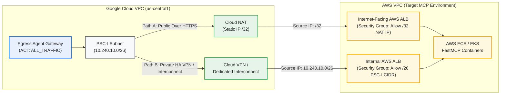

# Real AWS MCP Server Integration, Firewall & NAT Guide

> **Document Scope**: 본 문서는 기본 실습 모드인 `Simulated AWS FastMCP Server` (`TARGET_MODE=simulated_aws_vpc`) 검증을 마친 후, 실제 고객사의 **`AWS VPC` (`Amazon ECS Fargate`, `EKS`, `Application Load Balancer`)**에 호스팅된 운영 `MCP Server`로 전환할 때 필요한 **네트워크 방화벽(`AWS Security Group`), `AWS WAF`, `DNS`, `TLS 인증서 체인` 설정 체크리스트**를 정리합니다.

---

## 1. Switching from `simulated_aws_vpc` to `external_aws_url`

본 `Repository`는 `Code` 수정 없이 `.env` 환경변수만 변경하여 실제 `AWS MCP Endpoint`로 전환할 수 있도록 설계되어 있습니다.

### 1.1 `.env` 설정 변경
```bash
# .env 파일에서 TARGET_MODE를 external_aws_url로 변경하고 실제 AWS ALB / API Gateway 도메인을 입력합니다.
TARGET_MODE=external_aws_url
EXTERNAL_AWS_INVENTORY_MCP_URL=https://mcp-inventory.aws.enterprise.example.com/mcp
EXTERNAL_AWS_OMS_MCP_URL=https://mcp-oms.aws.enterprise.example.com/mcp
```

### 1.2 Agent Registry 재등록 실행
```bash
uv run python scripts/02_register_mcp_in_agent_registry.py --live
```

---

## 2. Network Path & AWS Security Group Configuration

`Agent Connectivity Template (ACT)`의 `ALL_TRAFFIC` 모드를 사용하면 `Google Managed Tenant`에서 발생한 모든 `MCP Tool Call`은 고객 `Google Cloud VPC`의 **`PSC-I Subnet (/26)`**으로 진입합니다. 이후 배포 아키텍처에 따라 다음 두 가지 경로 중 하나로 `AWS`에 도달합니다.



### Path A: Public Internet over HTTPS (`Cloud NAT Static IP /32`)
- **적용 대상**: `Google Cloud`와 `AWS` 간 전용선(`Interconnect`/`VPN`) 없이 공인 인터넷 구간 `TLS 1.3` 암호화 통신을 사용하는 경우
- **허용할 Source IP 확인**:
  ```bash
  gcloud compute addresses describe cymbal-aws-mcp-egress-ip \
    --region=us-central1 \
    --format="value(address)"
  ```
- **AWS Security Group Inbound Rule 설정**:
  - `Type`: `HTTPS (TCP 443)`
  - `Source`: `<CLOUD_NAT_STATIC_IP>/32`
  - `Description`: `Allow Google Cloud Egress Agent Gateway NAT IP`

### Path B: Private Interconnect / HA VPN (`PSC-I Subnet /26 CIDR`)
- **적용 대상**: `Google Cloud HA VPN` 또는 `Cloud Interconnect`를 통해 `AWS Transit Gateway / Virtual Private Gateway`와 사설망으로 연결된 경우
- **BGP 광고 설정**: `Google Cloud Router`의 **`Custom IP Ranges`**에 `PSC-I Subnet` 대역(`10.240.10.0/26`)을 추가하여 `AWS`로 `BGP Advertise`합니다.
- **AWS Security Group Inbound Rule 설정**:
  - `Type`: `HTTPS (TCP 443)`
  - `Source`: `10.240.10.0/26` (`PSC-I Subnet CIDR`)
  - `Description`: `Allow Google Cloud Agent Gateway PSC-I Subnet over VPN`

---

## 3. Critical Production Gotchas & Troubleshooting Checklist

실제 `AWS` 환경에 배포된 `MCP Server`와 연동할 때 가장 빈번하게 발생하는 4가지 장애 원인과 해결 방법입니다.

### 3.1 AWS WAF Bot Control `User-Agent` 차단 주의
- **현상**: `Gemini Enterprise` 또는 `Agent Gateway`에서 `AWS ALB` 호출 시 `HTTP 403 Forbidden` 발생
- **원인**: `AWS WAF`의 `AWSManagedRulesBotControlRuleSet` 또는 `Anonymous IP List`가 `Google Cloud` 런타임의 기본 `HTTP Client` 헤더(`User-Agent: python-httpx/...` 또는 `Google-Agent-Gateway/...`)를 자동화된 봇으로 오탐하여 차단합니다.
- **해결**: `AWS WAF`에서 위 `Cloud NAT Static IP (/32)`를 **`IP Set Allowlist`**로 최우선 등록하거나, `Custom Header` 검증 규칙을 사용합니다.

### 3.2 IPv4-Only 제약 (`DNS AAAA Record` 제거 필수)
- **현상**: `Agent Gateway`에서 간헐적 연결 타임아웃 또는 `Network Unreachable` 발생
- **원인**: 현재 `PSC Network Attachment` 기반 `Agent Connectivity Template (ACT)`은 **`IPv4-Only`**를 지원합니다. 대상 도메인에 `IPv6 (AAAA)` 레코드가 함께 등록되어 있으면 해석 실패가 발생할 수 있습니다.
- **해결**: `AWS Route 53` 및 `Google Cloud Private DNS Zone`에서 `MCP Endpoint` 도메인에는 **`A Record (IPv4)`만 구성**하고 `AAAA Record`는 제거합니다.

### 3.3 Full TLS Certificate Chain (`Leaf + Intermediate CA`) 필수
- **현상**: 브라우저나 `curl`에서는 접속되나 `Agent Gateway` 호출 시 `TLS Handshake Failed: unknown authority` 발생
- **원인**: 일반 브라우저는 누락된 `Intermediate CA` 인증서를 자동으로 다운로드(`AIA Fetching`)하지만, `Agent Gateway`의 Envoy 기반 보안 프록시는 서버가 **`Full Certificate Chain` (`Leaf Certificate` + `Intermediate CA Certificate`)**을 함께 제시하지 않으면 즉시 연결을 거부합니다.
- **해결**: `AWS ACM (Certificate Manager)` 또는 `Nginx`/`ALB`에 인증서 등록 시 반드시 `Intermediate CA Bundle`이 포함된 전체 체인을 구성하고 아래 명령으로 검증합니다:
  ```bash
  openssl s_client -connect mcp-inventory.aws.enterprise.example.com:443 -showcerts
  ```

### 3.4 Streamable HTTP (`MCP 2025-03-26+`) vs Legacy SSE Idle Timeout
- **현상**: 장시간 실행되는 `MCP Tool` 호출 시 중간에 연결이 끊어짐
- **해결**: `FastMCP` 서버를 `transport="streamable-http"` 모드로 실행하고, `AWS ALB`의 `Connection Idle Timeout`을 기본 `60초`에서 **`120초` 이상**으로 상향 설정합니다.
